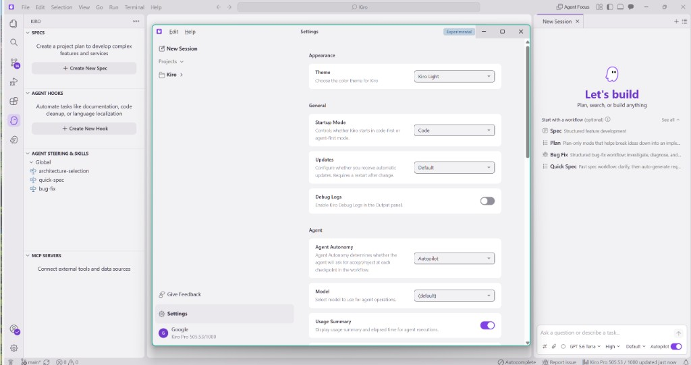
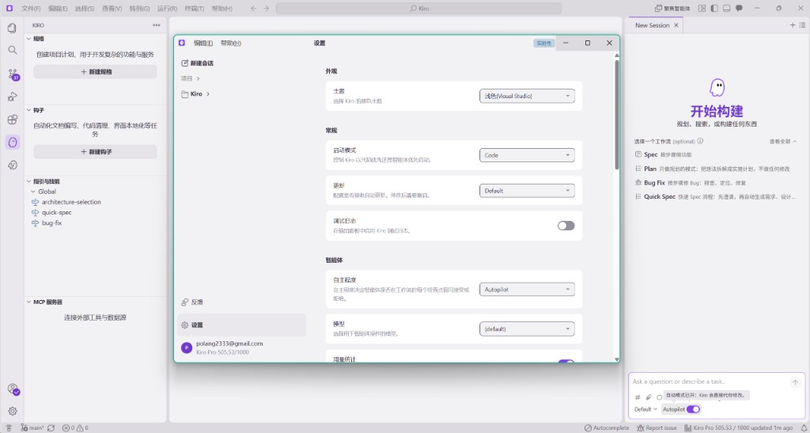

# Kiro Language Pack

Chinese translations for Kiro, including the editor, sessions, Settings, specs and steering. Supports Simplified Chinese and Traditional Chinese with Taiwan terminology.

[简体中文](README.md)


[](https://open-vsx.org/extension/polang233/kiro-language-pack)

| Before · English | After · 简体中文 |
| --- | --- |
|  |  |

## Command-line installation

Node.js 22+ is recommended; the minimum is 18.17. Quit Kiro completely first.

```bash
npx @polang233/kiro-language-pack@latest
```

The default command is `install`. It installs the language pack and translates text in the app files. Each npm version includes its matching VSIX, so users do not need to download or build the source. To switch languages or specify the install directory:

```bash
npx @polang233/kiro-language-pack@latest --locale=zh-cn
npx @polang233/kiro-language-pack@latest --locale=zh-tw
npx @polang233/kiro-language-pack@latest --dir="path/to/install"
```

| Subcommand | Purpose |
| --- | --- |
| `preview` | Preview changes |
| `status` | Report the current state |
| `restore` | Restore only the app files |

System locales with TW/HK/MO or zh-Hant select `zh-tw` with Taiwan terminology; all others select `zh-cn`. Override this with `--locale`. `--dir` selects the install directory containing `resources/app`, or `Kiro.app/Contents` on macOS.

Reopen Kiro after installation. Rerun the install command after an app update. Switch extensions and display language inside the app; `restore` does not uninstall the extension or reset the display language.

Test the source entry point from the repository. See [npm maintenance](docs/npm.md) for preparation:

```bash
node bin/cli.mjs preview --locale=zh-tw
```

## Extension installation

1. Uninstall other language packs to avoid conflicts with the official VS Code Chinese packs.
2. Search Extensions for **Kiro Language Pack** or **汉化**, or download a VSIX from [GitHub Releases](https://github.com/polang233/kiro-language-pack/releases) and use **Extensions: Install from VSIX…**.
3. Run **Language Pack: Select Display Language**, choose Simplified or Traditional Chinese, then quit Kiro completely and reopen it.

The extension id remains `polang233.kiro-language-pack`. The setting `kiroLanguagePack.language` also accepts `auto`, `zh-cn`, `zh-tw` and `en`; restart after changing it. Translating some text compiled into the app requires the command-line installation above.

The translations target Kiro **1.4.26** (Code OSS 1.131.0). New or untranslated text stays in English. UI language does not change AI reply language; use a steering file such as `.kiro/steering/language.md` for that.

## Development and license

[Maintenance and source tests](docs/npm.md) · [Publishing](docs/publishing.md) · [Architecture](docs/architecture.md) · [Contributing](CONTRIBUTING.md)

MIT. Workbench translations come from [microsoft/vscode-loc](https://github.com/microsoft/vscode-loc); see [NOTICE](NOTICE). A community project, unaffiliated with AWS or Microsoft.
